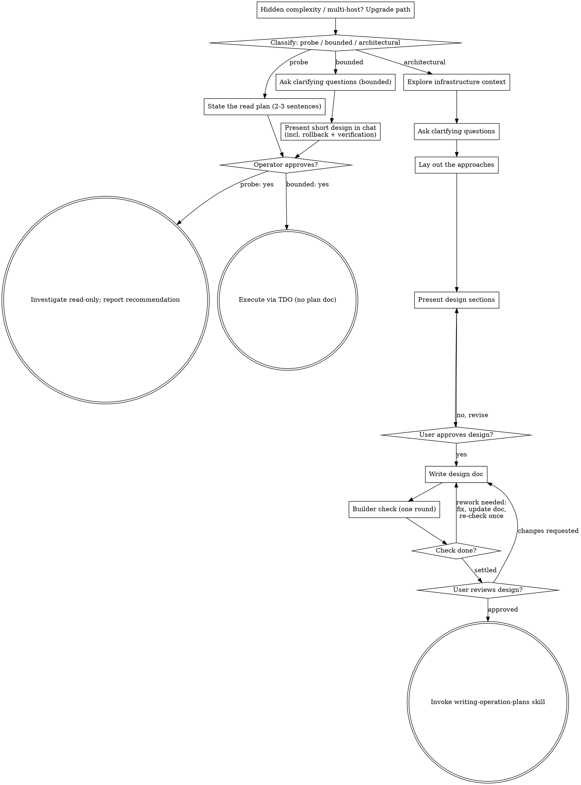

# Brainstorming Infrastructure Operations

## Overview

Help turn infrastructure operation ideas into fully formed designs through collaborative dialogue.

Start by classifying how much process the operation needs, then work through your path: understand the infrastructure state, refine the operation, present a design, and get the operator's approval.

**Announce at start:** "I'm using the brainstorming-operations skill to design this infrastructure operation."

**Save designs to:** `docs/plans/YYYY-MM-DD-<operation-name>-design.md`

## Look Before You Ask

When the operator has given you context — a ticket, a runbook, a handoff, a
spec, files they pointed at, earlier conversation — dig in before your first
message. Read what they referred to, and keep reading until you can explain
how the relevant parts work today and what this operation would touch. Never
ask what the ticket, the repo, or that context already answers.

Live infrastructure state is not theirs to hand you — it is read under the
path rules. For a bounded or architectural operation, read-only discovery is
allowed at any point (the HARD-GATE says so), so reading the live state this
change would touch is part of this section. But when the request itself is a
read-only investigation — a probe — do not read ahead of its gate: the
probe's approval IS its read plan, so state what you will read and get the
nod first, then dig in.

## Establish Shared Understanding

The outcome is an operation intent the operator can recognize and correct before
design choices harden around a wrong assumption.

**Your first message moves the work forward, in one of two shapes:**

- **They already said what they want** (a ticket, a spec, a plan, a detailed
  request): aim for about 200 words. Echo the request back in your own
  words, so they can see whether you have its shape — what they want, what
  it serves, and why, as far as they have said. Add what you found that
  bears on it: how the relevant parts work today and what the operation
  would touch. If you found something they may not have considered that
  would change what they are asking for or how it has to be executed — a
  constraint, a conflict, a cheaper path — say so plainly. End with one
  line inviting corrections, then one question about what they want: the
  thing their request leaves open whose answer would most change what gets
  executed. Tickets are often incomplete; confirm before you build on one.
- **They haven't:** one open question, in their terms, about the biggest
  thing their request leaves unsettled — the real incident or constraint:
  "Walk me through the last time this bit you" or "What does 'done' look
  like on your dashboard when this is fixed?" Say why you're asking: what
  the answer would change about the operation.

How the message ends depends on whether they asked for design work:

- **They asked for it** (a design discussion, a request to think it
  through): end with your question. They want this conversation.
- **They didn't:** they may not want a conversation at all. After your
  question, add a light, one-line offer to just proceed, like "Or if you'd
  rather I just get going, say so." If they take you up on it, this skill
  is done: state any significant choice you are making for them (approach,
  tool, ordering) in one plain line, then proceed through the normal
  workflow for the path the operation classifies into. A waiver of the
  questions is not a waiver of the approval gate for the path — classify,
  present the artifact the path requires, and get its approval.

**The conversation.** Each message ends with one question — a single sentence,
no list of example answers hanging off it (the first message's trailing
skip-offer, when there is one, is the sole exception). Open questions come
first: the
operator's own words carry intent that your options can't. Offer a short menu
only when they are stuck, or when the option space is genuinely closed and
enumerable (which cluster, which maintenance window). When they say "just
do what you think", propose something concrete. Match their vocabulary; never
use process jargon.

Build each question on their last answer or on something you found, the way
a sharp colleague would — so it helps them think through a consequence or
a case they may have missed ("The rollback you named restarts the node —
the canary pods live there. Does the window cover a pod bounce, or should
the rollback avoid the drain?"). When the reason isn't already plain, say
what you're hoping to learn or what the answer would change. A concrete
proposal they can correct, plus your reason for it, often beats a question.
You never need to quote this skill to the operator.

**Ground to cover** — territory, never read out as questions: the intended
outcome and who it serves; why now, and what success looks like to them;
goals, non-goals, and anti-goals (what would make this a failure even if it
technically works); prior art — what they have seen work or fail elsewhere;
the current state as they understand it; the constraints they care about.

**Offer recon.** Once you have a bit of grounding and reading live state would
help, say what you would read and how, and let them decide whether you go
(read-only discovery is allowed at any point).

**Play it back as you go.** As soon as you understand one part well enough —
the intent, the blast radius, one subsystem's role — describe that part back
in 200-300 words and end by asking what is wrong or missing. Only what the
operator confirmed goes in as theirs; anything you filled in goes in as
your proposal, with your reason. Playback and questions alternate through the
whole conversation; only what the operator confirmed goes into the design as
theirs. This replaces a single big "write back your understanding" dump at
the end: an error caught in a 200-word chunk costs one message; caught after
the design doc, it costs the document.

<HARD-GATE>
Before any mutating command or execution skill, complete the selected path's
prerequisites:

- **Probe:** the operator approves the question and read-only plan.
- **Bounded:** the operator approves the short in-chat design, including blast
  radius, rollback, and verification.
- **Architectural:** the operator reviews and approves the written design, then
  reviews the written operation plan and selects its execution method. In-chat
  design approval permits writing the design document; written-design approval
  permits invoking `writing-operation-plans`; neither approves a plan that did
  not exist yet.

A reply approves only the stage actually presented. Resume at the earliest
incomplete stage; do not turn one approval into permission to skip the rest of
the selected path. Read-only state discovery is allowed while prerequisites are
incomplete.

Two exceptions, both requiring the operator's explicit word:

- **They opted out of the questions** — the conversation is skipped, but the
  path's own approval gate still applies (see above). A gate the operator
  explicitly waves after being told what it protects is a recorded decision,
  not a silent one: say what was waived, and proceed — the gate is a default,
  not a lock. Repeating the objection after that decision is noise.
- **A sandbox experiment they approved** may mutate its sandbox — see
  [Sandbox Experiments](#sandbox-experiments). Keeping anything it produced is
  a new operation that comes back through this gate.
</HARD-GATE>

## Three Paths

Before your first question, classify the request:

- **Probe** — a **read-only** investigation whose output is an answer, not a change: "is the cert expiring", "which hosts are on 9.4", "why is p99 up". State what you will read and how, in 2-3 sentences, get a nod, then find out. No design doc, no plan file. Report findings as a recommendation. A probe is defined by *reading only* — the moment a diagnostic step would mutate anything (a restart "to see if it helps", a cache flush, a test write), it is no longer a probe: stop and re-classify.
- **Bounded** — a **single mutating change to infrastructure that already exists**, with a rollback you can write in one command and a blast radius of one host or one namespace: a Hiera value, one DNS record, one manifest field. Understanding the *kind* of system is not enough — bounded means the thing you are changing is already there to read, and you have read it. Ask the clarifying questions that matter, present a short design IN CHAT (a few sentences to a few short paragraphs) **including the rollback and the verification**, and STOP. Execution starts only after the operator says yes — a bounded operation's approval is as hard a gate as an architectural one. No design doc, no plan file.
- **Architectural** — new systems, fleet-wide or multi-host changes, anything touching a quorum, a VIP, or a shared dependency; anything whose rollback takes more than a command or two; anything on production. Follow the full process: questions, approaches, sectioned design, written design doc, then `srepowers-core:writing-operation-plans`.

When in doubt between two paths, take the heavier one. **The ratchet is one-way:** hidden complexity discovered mid-operation upgrades the path — stop, say so, and step up. Nothing downgrades mid-operation. Two ops-specific forced upgrades, regardless of how small the change looks:

- **Multi-host, or a shared dependency** (quorum member, keepalived pair, shared Hiera key, a VIP) → architectural. Correctness lives *between* the hosts, not in any one change.
- **A rollback you cannot state in one or two commands** → architectural. If you cannot write the undo within about ten seconds, the blast radius is not understood yet.

Say the classification out loud — "this is read-only, so I'll state the probe and run it rather than write a design doc" — so the operator can override it before work starts. If this is really several independent operations, say so, agree an order, and design them one at a time; a design that spans independent operations hides which approval covers which change.

## Anti-Pattern: "Too Simple To Need Approval"

Every path ends with the operator approving the required artifact before execution. A bounded config tweak may need only two sentences in chat; an architectural operation requires the written design and plan handoffs. Complete the selected path's reviews in order. "Simple" operations are where unexamined assumptions cause the most damage: the config tweak that restarts a pod without a PodDisruptionBudget, the "just restart" that clears a queue you needed, the cert renewal that breaks a pinned client. What scales with simplicity is the artifact, never the approval — and never the rollback or verification.

## Red Flags

| Thought | Reality |
|---------|---------|
| "This is too simple to need a design" | Simple means a short design, not no design. Two sentences plus rollback and verification, then approval. |
| "I'll call it bounded and skip the design doc" | Reaching for a label to skip work IS the doubt — take the heavier path. |
| "It's bounded and obvious — I'll start while they read it" | The gate is the approval, not the design's length. Present, then stop until you hear yes. |
| "I know this kind of cluster, so it's bounded" | Bounded measures the live system, not your familiarity. Unread state is architectural. |
| "It's one command per host, so it's still bounded" | Multi-host is architectural. Two correct single-host changes take down a pair. |
| "The probe showed the fix, so I'll just apply it" | A probe's output is an answer. Applying it is a new operation — classify it. |
| "A restart is just a diagnostic step" | A restart mutates. That is not a probe; re-classify before running it. |
| "It grew, but I'm almost done — no need to re-classify" | Hidden complexity upgrades the path mid-operation. Stop and say so. |
| "They approved the idea, so the design and plan are approved too" | Approval applies only to the stage presented. An artifact that did not exist could not have been reviewed. |
| "They approved the noop, so the apply is approved too" | Each action gets its own approval. An apply approval never carries to a reboot. |
| "I'll offer options to save them effort" | Options steer. Ask them to describe the outcome first; offer a menu only when stuck or the space is closed. |
| "I've answered their questions, so I'll write the doc" | Lay out the approaches first, in a message of their own. |
| "I'll fill in sensible defaults" | Good — but say them out loud. A default the operator never heard is one they couldn't reject. |
| "I should explain the process first" | Ask your question. The process shows itself. |
| "They said 'sounds good' to the approach" | Approval covers what you showed them. A design you haven't written isn't approved. |
| "The sandbox experiment works, I'll keep building on it" | Keeping what it produced is a new operation. Back through the gate. |
| "No maintenance window came up, I'll just proceed" | Ask. A change's window, notification list, and dependencies are design inputs, not formalities. |

## Process Flow

**Terminal states are path-bound.** Architectural: the ONLY skill you invoke after brainstorming is `srepowers-core:writing-operation-plans` — never test-driven-operation, subagent-driven-operation, or any other execution skill. Bounded: after approval, execution proceeds directly through `srepowers-core:test-driven-operation`; no design doc, no plan file. Probe: the terminal state is a reported recommendation.

## Checklist

Classify first, announce the path, then create a task for each item on your path and complete them in order.

**Probe:**
1. **State the read plan** — what you will read, with what commands, in 2-3 sentences
2. **Get approval** — a nod is enough
3. **Investigate** — read-only throughout; if a step would mutate, stop and re-classify
4. **Report findings** — a recommendation, with the evidence you read

**Bounded:**
1. **Read the live state you are about to change** — the current value, the resource as it exists now
2. **Ask clarifying questions** — one at a time, the ones that matter
3. **Present short design in chat** — the change, the blast radius, the rollback command, the verification
4. **Get approval** — STOP and wait for an explicit yes; presenting the design and starting in the same breath is skipping the gate
5. **Execute** — via `srepowers-core:test-driven-operation`; no plan document

**Architectural:**
1. **Explore infrastructure context** — current state (kubectl/terraform/configs), recent changes, known issues
2. **Ask clarifying questions** — one at a time; understand purpose, scope, constraints, risk level
3. **Lay out the approaches** — a message of their own: 2-3 alternatives grounded in the live state, trade-offs (downtime, rollback complexity, verification), your recommendation, and which way the operator picks
4. **Present design** — in sections scaled to complexity, get user approval after each section
5. **Write design doc** — save to `docs/plans/YYYY-MM-DD-<operation-name>-design.md` and commit
6. **Builder check** — dispatch the builder-check subagent (one round), sort its questions into answered / minor / theirs, bring only "theirs" to the operator
7. **User reviews written design** — ask the user to review the design file before proceeding
8. **Transition to planning** — invoke writing-operation-plans skill to create the execution plan

## The Process

The subsections below serve the bounded and architectural paths (a probe stops at "state the read plan, get a nod"). Sections from **Exploring approaches** onward are architectural-path depth — for bounded work, reading the live state plus a few questions plus a short in-chat design (change, blast radius, rollback, verification) is the whole process.

**Understanding the operation:**
- Check current infrastructure state (kubectl, configs, recent changes)
- Ask questions one at a time to refine the operation
- Open questions first; a short menu only when the operator is stuck or the option space is closed
- Focus on: purpose, scope, constraints, risk level — and why now, what they have seen fail before, and what would count as failure even if it technically works

**Lay out the approaches.** Once you understand what they want, and before
you write anything up, put the ways of executing it in a message of its
own. Come up with several real alternatives and drop the weak ones,
including any that work against why they want it and any the live state
rules out. Present the two or three that remain, grounding each in what the
infrastructure actually does and saying what it trades off — downtime,
rollback complexity, verification. Recommend one and say why, then ask
which way they want to go. When there's genuinely one sensible way, say so
and explain why the others don't fit. This is for how it gets executed; for
what they want, get them describing first.

**Presenting the design:**
- Break into sections of 200-300 words
- Play each section back; anything you filled in goes in as your proposal, with your reason, and ask what is wrong or missing
- Cover: current state, desired state, operation steps, verification commands, rollback plan, risk assessment

## Design Document Structure (architectural path)

| Section | What to Cover |
|---------|---------------|
| **Current State** | What infrastructure exists, recent changes, known issues |
| **Desired State** | What operation achieves, success criteria, rollback criteria |
| **Approaches** | The two or three ways considered, what each trades off, which the operator picked, and why — decided in the conversation, before the doc is written |
| **Operation Approach** | High-level steps, verification per step, rollback per step |
| **Risk Assessment** | Risk level (L/M/H), what could go wrong, rollback triggers |
| **Prerequisites** | Tools/access needed, info to gather, dependencies |
| **Business Impact** | Services affected, expected downtime, customer impact |

## Infrastructure Operation Patterns

| Operation Type | Risk Level | Key Considerations |
|----------------|------------|-------------------|
| **K8s Deployment Update** | Medium | Rolling update, pod health, traffic disruption |
| **Database Migration** | High | Data loss potential, rollback script, checksums |
| **Keycloak/IDP Change** | High | Auth disruption, token validation, user login tests |
| **Config/Secret Update** | Low-Medium | Pod restart, config validation, ArgoCD sync |
| **Network/Ingress Change** | Medium | DNS propagation, certificate validation, LB health |

## Questions to Ask

**Understanding scope:**
- What infrastructure components are affected?
- What's the current state? What's the desired state?
- Are there dependencies or prerequisites?
- Why now — what triggered this operation?
- What prior art has the operator seen — approaches that worked or failed elsewhere?
- Anti-goals: what would make this a failure even if it technically works?

**Risk assessment:**
- What's the worst-case scenario?
- How would we detect failure?
- What's the rollback strategy?

**Verification strategy:**
- How will we verify each step?
- What commands confirm success?
- What indicators show failure?

**Execution approach:**
- Can this be done incrementally?
- Are there maintenance windows?
- Who needs to be notified?

## Key Principles

| Principle | What It Means |
|-----------|---------------|
| **One question at a time** | Don't overwhelm with multiple questions |
| **Open questions first** | Options steer. A menu only when stuck or the space is closed |
| **Play it back as you go** | Alternate 200-300-word playback with questions; anything you filled in goes in as your proposal, with your reason |
| **Risk-focused** | Always consider what could go wrong and how to detect it |
| **Verification-first** | Design verification strategies before operation steps |
| **Rollback-aware** | Every operation should have a rollback plan |
| **Dry-run strategy** | Identify which commands support `--dry-run` |

## Sandbox Experiments

Sometimes the cheapest way to learn what the operation should be is to *run
something disposable*. Agentic operations are fast enough that a throwaway
experiment often beats three rounds of questions about an approach you have
never seen applied to this stack.

Offer one when seeing would beat telling: a scratch namespace or throwaway
cluster to try the migration path, a sit-environment canary of the new config,
a clone VM for the upgrade rehearsal. An approved sandbox experiment may
mutate its sandbox and nothing else. It stays labeled throwaway, gets no plan
document, and produces learning, not deliverables — **keeping anything it
produced is a new operation that comes back through the approval gate.**
When the operator just wants to experiment, get out of the way.

## Visual Companion (optional)

A browser-based companion for showing topology diagrams, failure-domain maps,
dashboard layouts, and side-by-side architecture options during brainstorming.
It is a tool, not a mode — accepting it means it is *available*, not that every
question goes through the browser.

**Opt-in and dependency-scoped:** the companion needs Node.js. The core
brainstorming workflow has no runtime dependency and must stay that way — never
make the companion a prerequisite for designing an operation.

**Offering it (just-in-time):** do NOT offer it upfront. Wait until a question
would genuinely be clearer shown than told — a real topology, layout, or
comparison question, not merely an infrastructure *topic*. The first time that
happens, offer it as its own message:

> "This next part might be easier if I show you — I can put together diagrams
> and side-by-side comparisons in a browser tab as we go. It's still new and can
> be token-intensive. Want me to? I'll open it for you."

**The offer MUST be its own message.** No clarifying question, summary, or other
content alongside it. Wait for the response. If they accept, start the server
with `--open`. If they decline, continue text-only and don't offer again unless
they raise it.

**Per-question decision:** even after acceptance, decide for each question. The
test: **would the operator understand this better by seeing it than reading it?**

- **Browser:** network topology, failure-domain and blast-radius maps, cluster
  or zone layout comparisons, before/after architecture diagrams, dashboard
  mockups
- **Terminal:** requirements questions, rollback strategy, verification-command
  choices, A/B/C/D text options, scope and maintenance-window decisions

A question about a topology *topic* is not automatically a visual question.
"What counts as a failure domain here?" is conceptual — use the terminal. "Which
of these two subnet layouts is better?" is visual — use the browser.

If they agree, read the detailed guide before proceeding:
[visual-companion.md](visual-companion.md).

**Security model (do not weaken):** the server issues a per-session key,
delivered in the URL and stored as a tab-scoped cookie; every HTTP and WebSocket
request must present it. It refuses symlinks, dotfiles, and path escapes, and
writes key-bearing files owner-only. Session files live under
`.srepowers/brainstorm/` (git-ignored) when `--project-dir` is passed, and in
`/tmp` otherwise.

## After the Design

**Documentation:**
- Write validated design to `docs/plans/YYYY-MM-DD-<operation-name>-design.md`
- Commit the design document to git

**Design Review — the builder check:**
After writing the design document, dispatch a fresh subagent with
[builder-check-prompt.md](builder-check-prompt.md) — a senior SRE who will
plan and execute the operation but *cannot talk to you*. Give it precisely
crafted review context, never your session history. When you tell the operator
you are writing the design up, say a reviewer will read it first and you may
come back once with a few questions.

Sort what the builder asks into three piles:

- **Answered already** by the conversation or the design — put the answer in
  the document.
- **Minor** — a sensible operator could settle it without changing what gets
  executed. Settle it yourself and mark it in the document as your call.
- **Theirs** — only the operator can answer it, and the answer changes what
  gets executed, its rollback, or its blast radius.

Bring the "theirs" pile to the operator in ONE message, most important first.
Update the document with their answers, then hand it over with a short list of
the calls you made so they can check those while reading. That is the only
round of questions the check produces — if the rework it demands is
substantial (the design's shape was wrong, not a detail), fix the document and
run the check once more; a third round means the design is fighting the
problem, and that goes back to the conversation, not to more review loops.
Without a subagent tool, read the document as that builder yourself.

**User Review Gate:**
After the design review loop passes, ask the user to review the written design before proceeding:
> "Design written and committed to `<path>`. Please review it and let me know if you want to make any changes before we start writing out the operation plan."

Wait for the user's response. If they request changes, make them and re-run the design review loop. Only proceed once the user approves.

**Planning:**
- Invoke **srepowers-core:writing-operation-plans** to create detailed execution plan
- Do NOT invoke any other skill. writing-operation-plans is the next step.
